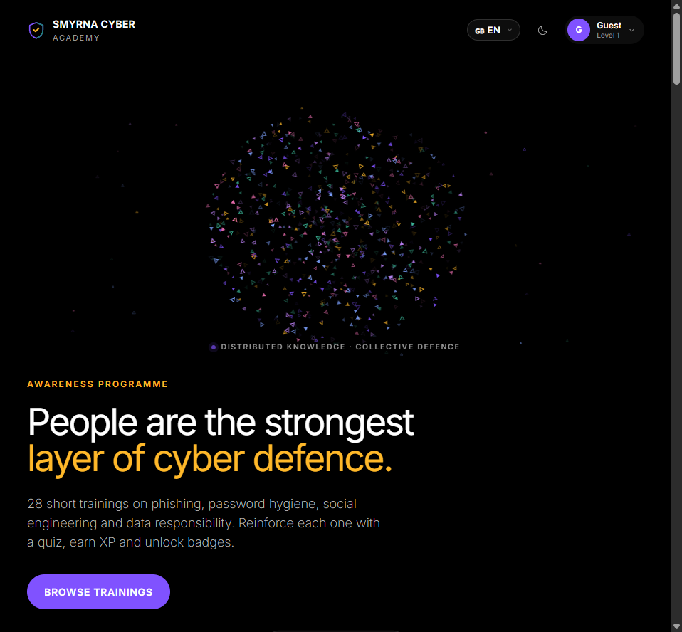

<h1 align="center">Smyrna Cyber-Awareness-Akademie</h1>

  Mehrsprachige Akademie mit 28 Lektionen, Fallstudien und Quizfragen. 
  Lernen Sie im Browser, verfolgen Sie Fortschritte und erhalten Sie ein Zertifikat.

  
  
  
  

  <a href="https://smyrna-pergamum.github.io/smyrna-cyber-awareness-academy/"><b>▶ Online testen</b></a>
  &nbsp;·&nbsp; <a href="https://github.com/smyrna-pergamum/smyrna-cyber-awareness-academy/releases/latest"><b>⬇ Neueste Version</b></a>
  &nbsp;·&nbsp; <a href="#funktionen">Funktionen</a>
  &nbsp;·&nbsp; <a href="#schnellstart">Schnellstart</a>

## Schnellstart

1. **Online:** Öffnen Sie die [Live-Akademie](https://smyrna-pergamum.github.io/smyrna-cyber-awareness-academy/).
2. **Offline:** [Laden Sie das Quell-ZIP herunter](https://github.com/smyrna-pergamum/smyrna-cyber-awareness-academy/archive/refs/heads/main.zip), entpacken Sie es und öffnen Sie `index.html`.
3. Sprache wählen, Profil erstellen oder als Gast fortfahren; Lektion und Fallstudie lesen und das Quiz abschließen.

Die App funktioniert offline. Online lädt sie Inter von Google Fonts; offline nutzt sie Systemschriften. Der Fortschritt wird im lokalen Browserspeicher gespeichert.

## Funktionen

- 28 Lektionen mit Lernzielen, Erklärungen, Fallstudie und separatem Quiz.
- Profile, XP, Badges und Quiz-Ergebnisse.
- Zertifikat nach Abschluss aller Lektionen und perfektem Ergebnis in allen Quizfragen.
- Türkisch, Englisch, Deutsch, Französisch, Spanisch, Arabisch und Russisch.
- Responsive Design, helle/dunkle Themen und RTL-Unterstützung für Arabisch.

## Version und Lizenz

[Version v1.0.0](https://github.com/smyrna-pergamum/smyrna-cyber-awareness-academy/releases/tag/v1.0.0) · [Versionsverlauf](CHANGELOG.md) · [MIT-Lizenz](LICENSE)

